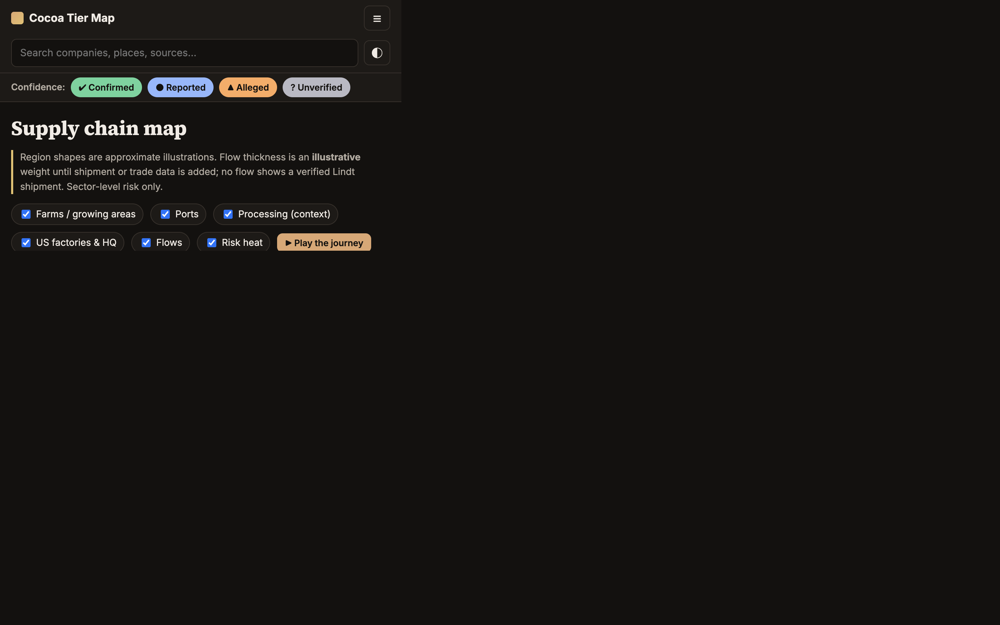

# Lindt Cocoa Tier Map

An open-source-intelligence (OSINT) map of how cocoa from Ghana and Côte d'Ivoire, where child labor in cocoa is documented at scale, reaches US shelves under Lindt & Sprüngli's US brands (Lindt, Ghirardelli, Russell Stover). It is anchored on the July 2026 US lawsuit against Lindt.

**Live site:** https://belianakrashi.github.io/lindt-cocoa-tier-map/

## What it shows
Overview · Supply Chain Map (Leaflet) · Tier Explorer (D3 network) · Promises vs. Reality timeline · Data Dashboard (Chart.js, CSV downloads) · The Lawsuit · Evidence Locker · Methodology & Gaps · About. Each tab has a shareable `#hash` link; a confidence filter (Confirmed / Reported / Alleged / Unverified) and global search apply everywhere.

## Run locally
No build step. ES modules need HTTP, so run `python3 -m http.server 8000` in this folder and open http://localhost:8000.

## Update the data (no code changes)
All content lives in `data/`: `entities.json`, `relationships.json`, `geo.json`, `timeline.json`, `sources.json`, `imports.csv`, `norc.json`, `site.json`. Every record carries `sources` (URL + date accessed) and a `confidence`.
`imports.csv` is currently header-only. Add rows with `dataset=usitc_dataweb` (USITC DataWeb, HS 1801/1803/1804) or `dataset=importyeti` and the charts and overview stat fill in automatically.

## Key sources
NORC / US Department of Labor child-labor assessment (2018/19); DOL Harkin-Engel and List of Goods pages; ConfectioneryNews and Claims Journal coverage of the complaint; Lindt press releases and sustainability reporting. Full list: `data/sources.json` or the Evidence Locker tab.

## Legal and ethics note
Independent research from public sources; not legal advice. Statements about the lawsuit are **allegations** by the plaintiff (International Rights Advocates) and Lindt denies them. This project maps sector-level risk and the gap between public claims and documented conditions. It does **not** claim any specific Lindt, Ghirardelli or Russell Stover product was made with child labor. News sources are paraphrased. No images or names of children are used. Corrections are welcome via GitHub issues.

## Basemap note
CARTO raster tiles now require an API key, so Esri Gray Canvas tiles are used (configurable in `data/geo.json` → `basemap`).

See [METHODOLOGY.md](METHODOLOGY.md) for methods and limitations.
